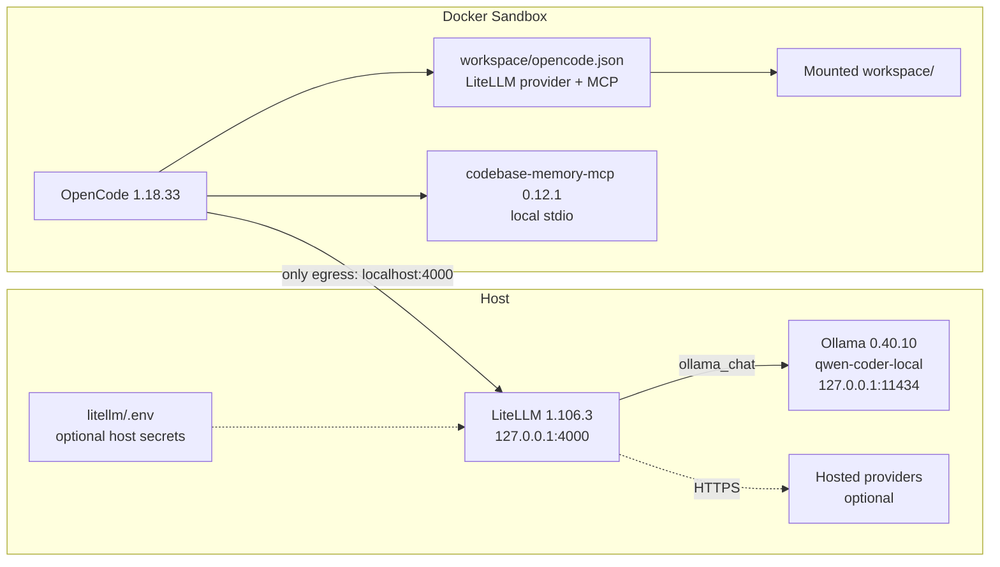
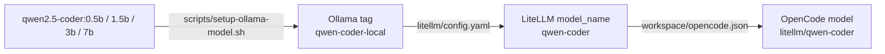

# OpenCode Docker Sandbox with MCP Servers

This project runs OpenCode in Docker Sandboxes with MCP servers installed into
the sandbox image and a host-side LiteLLM gateway. The sandbox has exactly one
model egress path: LiteLLM. LiteLLM reaches Ollama on the host (Qwen2.5-Coder
7B) and, when enabled, hosted providers such as DeepSeek.

All runtime components are pinned by version plus digest or hash. See
[SECURITY.md](SECURITY.md) for the pins, audit gate, and accepted risks. The
upstream OpenCode workload image currently has an open finding; see
[Known issue](#known-issue-opencode-workload-image).

## Architecture

OpenCode runs inside the sandbox. LiteLLM and Ollama run on the host. The
sandbox has one model egress path: the host-side LiteLLM gateway.



The three layers are:

1. **Sandbox**: OpenCode and the MCP server. The agent can write the mounted
   `workspace/` only.
2. **Host gateway**: LiteLLM accepts OpenAI-compatible requests on loopback
   and holds any provider credentials. It is the only model egress.
3. **Host model backend**: Ollama serves `qwen-coder-local`; hosted providers
   are optional and reached only by LiteLLM.

The sandbox-facing name `host.docker.internal` is rewritten to `localhost` by
the sandbox proxy, which is why the egress rule names `localhost:4000`.

### Model routing



The OpenCode label is cosmetic; the actual base is whichever
`qwen-coder-local` points to. Run `ollama ps` to see the loaded model.

## Layout

```text
.
├── .trivyignore.yaml           # scoped, expiring audit exceptions
├── .yamllint.yaml              # YAML style config for pre-commit
├── sbxenv.yaml                 # sandbox, kit list, LiteLLM endpoint
├── sbxenv.dsh.yaml             # experimental DeepSeek Harness sandbox
├── SECURITY.md                 # pins, audit, accepted risks
├── litellm/
│   ├── .python-version         # 3.12.15 for the uv project
│   ├── config.yaml             # model_list: local Qwen, DeepSeek commented
│   ├── pyproject.toml          # litellm[proxy]==1.106.3
│   ├── uv.lock                 # universal, hash-locked
│   └── run.sh                  # uv sync --frozen + uv run on 127.0.0.1
├── models/
│   ├── ollama-model-digests.txt # base model -> manifest SHA-256
│   └── qwen-coder-7b.Modelfile  # 32k context + low temperature overlay
├── mcps/                       # one self-contained mixin per MCP server
│   ├── README.md               # conventions and add-a-server checklist
│   └── codebase-memory-mcp/
│       ├── kit.yaml            # v3 mixin descriptor: pinned version, agent context
│       ├── kit.Dockerfile      # pinned base + hardcoded release hashes
│       ├── context.md          # instructions appended to the agent's AGENTS.md
│       └── README.md           # upstream, pin, verification, update notes
├── providers/
│   └── litellm/kit.yaml        # the only model egress rule
├── scripts/
│   ├── audit.sh                # trivy vulnerability gate
│   ├── check-jsonc.py          # JSONC validator for opencode.example.jsonc
│   ├── install-uv.sh           # verifies + installs pinned uv 0.13.5
│   ├── setup-ollama-model.sh   # pull base + create qwen-coder-local
│   ├── uv                      # wrapper for the pinned uv
│   └── verify-ollama-model.sh  # model manifest digest check
├── dsh/                        # experimental DeepSeek Harness workload
│   ├── kit.yaml                # v3 workload: dsh web
│   ├── kit.Dockerfile          # uv image + Python 3.12 + DSH SDK
│   ├── pyproject.toml          # deepseek-harness-sdk==0.2.1rc2
│   ├── uv.lock                 # hash-locked DSH runtime wheel
│   └── workspace/              # mounted DSH workspace
└── workspace/
    ├── opencode.json           # LiteLLM provider + MCP registration
    └── opencode.example.jsonc  # commented samples for more models
```

The sandbox cannot reach Ollama or `api.deepseek.com` directly. Only
`localhost:4000` (LiteLLM, through the proxy) is allowed.

## Add an MCP server

1. Copy `mcps/codebase-memory-mcp/` to `mcps/<name>/` and edit the four files.
   `kit.yaml` and `kit.Dockerfile` must keep the same filename stem (`kit`).
   The directory name, not the filenames, identifies the server.
2. In `mcps/<name>/kit.yaml`, set `displayName`, `description`, `sourceUrl`,
   `licenses`, and the pinned `args.version.default`. Point
   `capabilities[agent-context].config.contentFile` at your `context.md`.
3. In `mcps/<name>/kit.Dockerfile`, pin the base image by digest, install the
   binary at a stable absolute path such as `/usr/local/bin/<name>`, verify the
   download against a hash committed in the Dockerfile, and smoke-test it
   (`--version`) during the build.
4. Append the directory to `kits:` in `sbxenv.yaml`:

   ```yaml
   kits:
     - docker.io/docker/sbx-kit-opencode:1.18.33@sha256:11d794b51c3f36be5b1f0b4fe59512970eacf1bff35eec50bf223c0825b0a25d
     - ./mcps/codebase-memory-mcp
     - ./mcps/<name>
   ```

5. Register the same binary in `workspace/opencode.json` so OpenCode starts it
   inside the sandbox:

   ```json
   {
     "mcp": {
       "<name>": {
         "type": "local",
         "command": ["/usr/local/bin/<name>"],
         "enabled": true,
         "timeout": 30000
       }
     }
   }
   ```

Then run `sbx env plan` and inspect the new kit entry before applying.
`mcps/README.md` has the full checklist and conventions.

## Why servers are registered in `workspace/opencode.json`

Docker Sandboxes' MCP gateway (`sbx mcp`, `mcp.servers` in `sbxenv.yaml`) runs
local stdio servers on the **host**. The servers in this project are installed
into the **sandbox image**, so they are registered as project-level OpenCode
configuration instead: OpenCode starts them inside the sandbox, where the
binary and its view of the mounted workspace live. The OpenCode workload
separately registers the gateway (when one is active) in
`~/.config/opencode/opencode.json` at startup; OpenCode merges that with the
project configuration.

## Prerequisites

- Docker Sandboxes `sbx` CLI 0.48.0 (tested) with environment-file and Kit v3
  support.
- Docker Buildx.
- Ollama 0.40.10 on the host.
- `curl` and `tar` for the pinned uv installer.
- A supported host OS/hypervisor as listed in Docker's current Sandboxes
  installation docs.

Kit v3 and `sbx env` are experimental. Check current Docker docs if your CLI
rejects a field.

## Pinned versions

- OpenCode workload:
  `docker.io/docker/sbx-kit-opencode:1.18.33@sha256:11d794b51c3f36be5b1f0b4fe59512970eacf1bff35eec50bf223c0825b0a25d`
- codebase-memory-mcp: 0.12.1, release archive hashes committed in
  `mcps/codebase-memory-mcp/kit.Dockerfile`
- MCP build base:
  `docker/sandbox-templates:shell-docker@sha256:b178ca62ec2e79af2a044e3ec321bdb72188690e1c15d573ea5524b397554d3d`
- LiteLLM: 1.106.3, locked in `litellm/uv.lock` (`uv sync --frozen`)
- Python: 3.12.15 (`litellm/.python-version`)
- uv: 0.13.5, installed by `scripts/install-uv.sh` (checksum-verified)
- Ollama: 0.40.10
- qwen2.5-coder digests: pinned in `models/ollama-model-digests.txt`
  (0.5b, 1.5b, 3b, 7b)
- DSH SDK: 0.2.1rc2, locked in `dsh/uv.lock`; runtime wheel is
  `deepseek-harness-runtime-bin==0.2.1rc2`
- DSH uv builder:
  `ghcr.io/astral-sh/uv:0.13.5@sha256:32a7bb39b496babbd997b0a39a4d66c126bdaf5661b302bf6f06abda8deca6ff`
- DSH Python: 3.12.15 (`dsh/.python-version`)

`SECURITY.md` lists the full digests and the audit procedure.

## Set up the host

Ollama must be 0.40.10. If you install it manually, verify the release asset
against the checksums in [SECURITY.md](SECURITY.md).

```bash
ollama --version                    # must print 0.40.10
scripts/setup-ollama-model.sh       # 7B default, uses the committed Modelfile
# quick test model:
# scripts/setup-ollama-model.sh qwen2.5-coder:0.5b
```

Start the pinned LiteLLM gateway. It creates `litellm/.venv`, runs
`uv sync --frozen` (hash-verified), disables telemetry, and binds
`127.0.0.1:4000`:

```bash
scripts/install-uv.sh    # verifies the checksum, installs uv 0.13.5
litellm/run.sh
```

## Environment variables

The default local setup needs no `.env` file. Required values are set where
they belong:

- `litellm/run.sh` exports `LITELLM_TELEMETRY_DISABLED=true` and
  `LITELLM_DANGEROUSLY_PERMIT_WEAK_OR_UNSET_MASTER_KEY=true` for the
  loopback-only gateway.
- `sbxenv.yaml` sets `LITELLM_BASE_URL=http://host.docker.internal:4000/v1`
  for OpenCode.
- `providers/litellm/kit.yaml` allows `localhost:4000` literally. sbx resolves
  kit capabilities before `sbxenv` `env:` is visible to `kit.env`, so this
  value cannot use `${{ kit.env... }}`. Changing the gateway port means
  updating the kit, `litellm/run.sh`, and `LITELLM_BASE_URL`.

There is no single file for every variable: `sbxenv.yaml` and the kit are the
sandbox side, while `litellm/run.sh` and optional `litellm/.env` are the host
side. Keep those two groups separate.

Optional values:

- `DEEPSEEK_API_KEY` — only when enabling the commented DeepSeek model. Put
  it in `litellm/.env` (copy `litellm/.env.example`; the file is gitignored
  and loaded by `run.sh`), or export it before `litellm/run.sh`.
- `OLLAMA_NUM_CTX` and `OLLAMA_LOCAL_TAG` — shell variables for
  `scripts/setup-ollama-model.sh`, for example
  `OLLAMA_NUM_CTX=16384 scripts/setup-ollama-model.sh qwen2.5-coder:0.5b`.
- `OLLAMA_MODELS` — only if Ollama stores models outside `~/.ollama/models`.

Do not commit `litellm/.env`. The sandbox never receives the DeepSeek key; it
is used only by LiteLLM on the host.

## Plan and run the sandbox

```bash
sbx env plan ./sbxenv.yaml
sbx env run ./sbxenv.yaml
```

Inspect the plan before approving it. Kits, env, and secrets take effect when
the sandbox is created; recreate it after changing them.

## DeepSeek Harness workload (experimental)

`sbxenv.dsh.yaml` runs the DSH web UI in a dedicated sandbox. This is a
separate, experimental workload; the OpenCode setup above is unchanged.

```bash
sbx env plan ./sbxenv.dsh.yaml
sbx env run ./sbxenv.dsh.yaml
```

Open the token URL after the sandbox starts. DSH writes it to
`/home/agent/.dsh/web.log`; retrieve it with:

```bash
sbx exec dsh-sandbox cat /home/agent/.dsh/web.log
```

Open the printed `127.0.0.1:3000` URL with its `?token=...` part.

- `dsh/` is a v3 workload built from the pinned uv image. DSH is installed
  with `uv sync --frozen`; pip is not used.
- `dsh web` is the full web profile; the limited `sdk-minimal` profile is not
  used.
- Model calls go through LiteLLM, so the sandbox has no DeepSeek key and no
  provider egress.
- The web UI is published on host loopback only.
- DSH is experimental and has no security audit; see [SECURITY.md](SECURITY.md).

## Models

The default model is `qwen-coder`, backed by the local Ollama tag
`qwen-coder-local`. `scripts/setup-ollama-model.sh` creates it:

- with no argument, it pulls `qwen2.5-coder:7b` and uses the committed
  `models/qwen-coder-7b.Modelfile` (32k context, temperature 0.2);
- with a base tag, it pulls that model and generates a temporary Modelfile
  with the same settings.

To test a smaller model, run
`scripts/setup-ollama-model.sh qwen2.5-coder:0.5b`. The script replaces
`qwen-coder-local`; LiteLLM and OpenCode keep the same `qwen-coder` alias, so
no configuration changes are needed. Rerun the script with no argument to
switch back to 7B.

`OLLAMA_NUM_CTX=16384` overrides the context for generated test models; keep
`limit.context` in `workspace/opencode.json` in sync. The 0.5b, 1.5b, 3b, and
7b base digests are pinned in `models/ollama-model-digests.txt`; unpinned test
tags skip verification with a warning.

Switch models per session with `/models`.

To add a local model: create its Ollama tag with `num_ctx`, add a
`model_list` entry in `litellm/config.yaml`, add the alias under
`provider.litellm.models` in `workspace/opencode.json`, and select it. No
sandbox recreation is needed because the kit and env do not change.

To add a hosted provider through LiteLLM: add the deployment and key in
`litellm/config.yaml` (for example `deepseek/deepseek-v4-pro` with
`os.environ/DEEPSEEK_API_KEY`), add the alias, restart LiteLLM, and select it.
The sandbox still only reaches LiteLLM; no new egress rule is required.
`workspace/opencode.example.jsonc` has commented samples for both cases.

## Validation

Run these after setup and after every pin change.

```bash
# 1. The pinned kit resolves.
sbx kit inspect \
  docker.io/docker/sbx-kit-opencode@sha256:11d794b51c3f36be5b1f0b4fe59512970eacf1bff35eec50bf223c0825b0a25d

# 2. The environment resolves with the LiteLLM kit and both env vars.
sbx env plan ./sbxenv.yaml

# 3. The LiteLLM lock is unchanged and installs frozen.
cd litellm
../scripts/uv lock --check
../scripts/uv sync --frozen --no-dev
../scripts/uv run --frozen --no-dev litellm --version
cd ..

# 4. Dependency and image audit; fails on HIGH/CRITICAL findings.
scripts/audit.sh

# 5. Host gateway answers.
curl -s http://127.0.0.1:4000/v1/models
curl -s http://127.0.0.1:4000/v1/chat/completions \
  -H 'Content-Type: application/json' \
  -d '{"model":"qwen-coder","messages":[{"role":"user","content":"Say OK"}]}'
```

Then verify from inside the sandbox:

```bash
sbx exec -it opencode-with-mcps bash
curl -s http://host.docker.internal:4000/v1/models
```

Expected:

- `sbx kit inspect` prints the OpenCode kit at the pinned digest.
- `sbx env plan` lists `./mcps/codebase-memory-mcp` and
  `./providers/litellm`, plus `LITELLM_EGRESS` and `LITELLM_BASE_URL`.
- `scripts/audit.sh` passes for the LiteLLM lockfile, MCP Dockerfile, and MCP
  base image. It fails on the pinned OpenCode workload image; see Known issue.
- LiteLLM returns a non-empty model list containing `qwen-coder`.
- The sandbox sees LiteLLM at `localhost:4000`.
- In OpenCode, `/models` shows `LiteLLM` / `qwen-coder` and `/mcp` shows
  `codebase-memory-mcp`.

Confirm that Ollama is **not** reachable from the sandbox:

```bash
curl -s --max-time 3 http://host.docker.internal:11434/api/tags \
  && echo "UNEXPECTED: Ollama is reachable" \
  || echo "blocked as expected"
```

The last command must print `blocked as expected`.

## Known issue: OpenCode workload image

The latest published OpenCode kit (`1.18.33`) is built on Debian 13.7 and has
54 HIGH, fixable CVEs in its OS packages (bind9, curl, libexpat,
linux-libc-dev). The kit is upstream-owned and immutable; no newer kit is
published, so this repository cannot patch it by changing a pin.

`scripts/audit.sh` intentionally fails on this image. The sandbox's egress is
limited to LiteLLM and the MCP/model processes run inside the sandbox, but the
package-level risk remains.

Options:

- Accept the documented upstream risk until Docker republishes the kit, then
  bump the digest and re-run the audit.
- Build and publish a custom OpenCode workload from a patched base image, pin
  its digest in `sbxenv.yaml`, and replace the upstream kit.

## Verify MCP

In OpenCode, use `/mcp` to inspect server status. Each configured server is a
local stdio process, so OpenCode starts it inside the sandbox. It can read files
available in the mounted workspace and stores its index/cache under the sandbox
user's home by default.

If one fails to start, run in a sandbox shell:

```bash
command -v codebase-memory-mcp
codebase-memory-mcp --help
```

Use the binary path from the server's `mcps/<name>/kit.Dockerfile`.

## Updating pins

Follow [SECURITY.md](SECURITY.md#updating): change the pin, regenerate the
lock with `cd litellm && ../scripts/uv lock`, run
`../scripts/uv sync --frozen --no-dev`, then
`scripts/audit.sh`, recreate the sandbox, and repeat the validation commands
above.

## Pre-commit

Install the hooks once:

```bash
pre-commit install
```

The default stage runs fast, mostly offline checks: file hygiene, shellcheck,
yamllint, JSONC parsing, markdownlint, codespell, hadolint, `uv lock --check`,
and gitleaks. `uv lock --check` uses the pinned uv from `.tools/`;
run `scripts/install-uv.sh` once first.

The vulnerability audit is a manual hook because it needs Trivy, Docker, and a
network-updated database (and currently fails on the upstream OpenCode image):

```bash
pre-commit run --hook-stage manual trivy-audit
```

## Security notes

- The sandbox has one model egress rule: `localhost:4000` (LiteLLM).
- Provider keys stay in LiteLLM's host environment; the sandbox never sees them.
- Ollama binds `127.0.0.1` and is not reachable from the sandbox.
- One HIGH advisory is documented rather than fixed: filelock
  CVE-2026-112940. LiteLLM 1.106.3 requires `filelock<4.0`, so the fixed
  4.2.1 cannot be installed. See [SECURITY.md](SECURITY.md) and
  `.trivyignore.yaml`.
- LiteLLM binds loopback and runs unauthenticated through the explicit
  `LITELLM_DANGEROUSLY_PERMIT_WEAK_OR_UNSET_MASTER_KEY` local-only override in
  `run.sh`. On a shared host, set `LITELLM_MASTER_KEY` and give the sandbox the
  key instead.
- MCP servers run inside the sandbox, not as host-side processes.
- OpenCode can modify files in the mounted workspace.
- Keep credentials and sandbox configuration outside the writable workspace.
- Review third-party MCP and model assets before use; pin releases and verify
  hashes.
