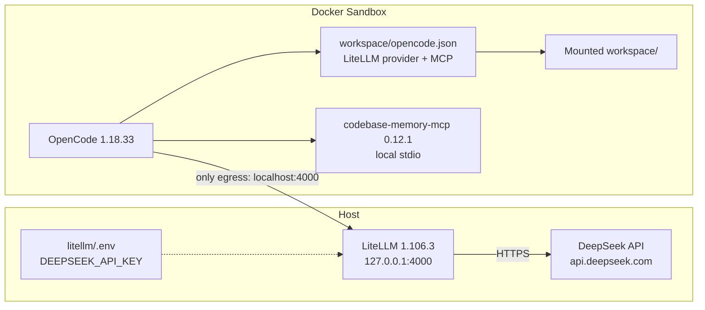
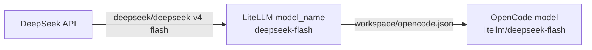

# Sandboxed LLM Coding Environments with MCPs

This repository is a template for reproducible Docker Sandbox environments
that run coding agents against hosted or local LLMs. Each environment mounts
one project workspace, installs its tools into the sandbox image, and keeps
provider credentials and model egress on the host.

It is designed to be extended:

- **Models** are reached through a host-side LiteLLM gateway. The sandbox has
  no provider key and exactly one model egress path. Hosted DeepSeek is active;
  the local Qwen/Ollama scripts and model assets remain for experimentation.
- **MCP servers** can run inside the sandbox as self-contained stdio binaries
  or be bridged from the host over HTTP. `codebase-memory-mcp` runs in the
  image; the Flutter project uses an in-sandbox Dart MCP server.
- **Agents** can be OpenCode or DeepSeek Harness ACP in IntelliJ. They share
  LiteLLM and the egress policy but use separate workspaces.

| Environment | Agent | MCP mode |
| --- | --- | --- |
| `sbxenv.yaml` | OpenCode | in-sandbox `codebase-memory-mcp` |
| `sbxenv.dsh.yaml` | DSH ACP / IntelliJ | none |
| `sbxenv.flutter.yaml` | DSH ACP / IntelliJ | codebase-memory + in-sandbox Dart MCP |
| `sbxenv.java.yaml` | DSH ACP / IntelliJ | codebase-memory; GraalVM JDK 25 |

All active environments also install the pinned OpenSpec CLI for spec-driven
development; it is a project tool, not an MCP server.

All runtime components are pinned by version plus digest or hash. See
[SECURITY.md](SECURITY.md) for the pins, audit gate, and accepted risks. The
upstream OpenCode workload image currently has an open finding; see
[Known issue](#known-issue-opencode-workload-image).

This repository was developed with the help of DeepSeek Harness.

## Architecture

OpenCode runs inside the sandbox. LiteLLM runs on the host and reaches hosted
DeepSeek.



The three layers are:

1. **Sandbox**: OpenCode and the MCP server. The agent can write the mounted
   `workspace/` only.
2. **Host gateway**: LiteLLM accepts OpenAI-compatible requests on loopback
   and holds the DeepSeek key. It is the only model egress.
3. **Host model backend**: hosted DeepSeek only.

The sandbox-facing name `host.docker.internal` is rewritten to `localhost` by
the sandbox proxy, which is why the egress rule names `localhost:4000`.

### Model routing



The DSH ACP workload uses the same LiteLLM alias. Local Qwen assets remain in
the repository but are not referenced by the active configuration.

## Layout

```text
.
├── .trivyignore.yaml           # scoped, expiring audit exceptions
├── .yamllint.yaml              # YAML style config for pre-commit
├── sbxenv.yaml                 # sandbox, kit list, LiteLLM endpoint
├── sbxenv.dsh.yaml             # experimental DeepSeek Harness sandbox
├── sbxenv.deepseek.yaml        # plain DSH/DeepSeek sandbox
├── sbxenv.deepseek.local.example.yaml # optional project workspace
├── sbxenv.flutter.yaml         # local Flutter host-MCP environment
├── sbxenv.java.yaml            # local Quarkus/GraalVM environment
├── sbxenv.java.local.example.yaml # gitignored project path template
├── SECURITY.md                 # pins, audit, accepted risks
├── litellm/
│   ├── .python-version         # 3.12.15 for the uv project
│   ├── config.yaml             # model_list: hosted DeepSeek
│   ├── pyproject.toml          # litellm[proxy]==1.106.3
│   ├── uv.lock                 # universal, hash-locked
│   └── run.sh                  # uv sync --frozen + uv run on 127.0.0.1
├── models/                    # optional local Qwen (disabled)
│   ├── ollama-model-digests.txt # base model -> manifest SHA-256
│   └── qwen-coder-7b.Modelfile  # 32k context + low temperature overlay
├── mcps/                       # one self-contained mixin per MCP server
│   ├── README.md               # conventions and add-a-server checklist
│   └── codebase-memory-mcp/
│       ├── kit.yaml            # v3 mixin descriptor: pinned version, agent context
│       ├── kit.Dockerfile      # pinned base + hardcoded release hashes
│       ├── context.md          # instructions appended to the agent's AGENTS.md
│       └── README.md           # upstream, pin, verification, update notes
├── tools/
│   ├── openspec/               # pinned OpenSpec CLI for mounted projects
│   │   ├── kit.yaml
│   │   ├── kit.Dockerfile
│   │   ├── context.md
│   │   └── README.md
│   ├── java/                   # GraalVM JDK 25 for Linux arm64
│   │   ├── kit.yaml
│   │   ├── kit.Dockerfile
│   │   ├── context.md
│   │   └── README.md
│   └── dart/                   # Dart SDK 3.13.5 + Dart MCP
│       ├── kit.yaml
│       ├── kit.Dockerfile
│       ├── mcp.patch.yml
│       ├── context.md
│       └── README.md
├── providers/
│   ├── litellm/kit.yaml        # the only model egress rule
│   └── java-egress/            # Gradle/Maven egress
│       └── kit.yaml
├── scripts/
│   ├── audit.sh                # trivy vulnerability gate
│   ├── acp-normalize.py        # converts ACP resource prompts to text
│   ├── check-jsonc.py          # JSONC validator for opencode.example.jsonc
│   ├── install-uv.sh           # verifies + installs pinned uv 0.13.5
│   ├── dsh-acp-sandbox.sh      # IntelliJ ACP bridge into dsh-sandbox
│   ├── setup-ollama-model.sh   # pull base + create qwen-coder-local
│   ├── uv                      # wrapper for the pinned uv
│   └── verify-ollama-model.sh  # model manifest digest check
├── dsh/                        # experimental DeepSeek Harness workload
│   ├── kit.yaml                # v3 workload: DSH ACP
│   ├── kit.Dockerfile          # uv image + Python 3.12 + DSH SDK
│   ├── pyproject.toml          # deepseek-harness-sdk==0.2.1rc2
│   ├── uv.lock                 # hash-locked DSH runtime wheel
│   └── workspace/              # mounted DSH workspace
└── workspace/
    ├── opencode.json           # LiteLLM provider + MCP registration
    └── opencode.example.jsonc  # commented samples for more models
```

The sandbox cannot reach Ollama or `api.deepseek.com` directly. The default
environment allows only `localhost:4000` (LiteLLM, through the proxy). The
Flutter project environment has no host MCP bridge; Dart MCP runs in the
sandbox.

## Add an MCP server

1. Copy `mcps/codebase-memory-mcp/` to `mcps/<name>/` and edit the four files.
   `kit.yaml` and `kit.Dockerfile` must keep the same filename stem (`kit`).
   The directory name, not the filenames, identifies the server.
2. In `mcps/<name>/kit.yaml`, set `displayName`, `description`, `sourceUrl`,
   `licenses`, and the pinned `args.version.default`. Point
   `capabilities[agent-context].config.contentFile` at your `context.md`.
3. In `mcps/<name>/kit.Dockerfile`, pin the base image by digest, install the
   binary at a stable absolute path such as `/usr/local/bin/<name>`, verify the
   download against a hash committed in the Dockerfile, and smoke-test it
   (`--version`) during the build.
4. Append the directory to `kits:` in `sbxenv.yaml`:

   ```yaml
   kits:
     - docker.io/docker/sbx-kit-opencode:1.18.33@sha256:11d794b51c3f36be5b1f0b4fe59512970eacf1bff35eec50bf223c0825b0a25d
     - ./mcps/codebase-memory-mcp
     - ./mcps/<name>
   ```

5. Register the same binary in `workspace/opencode.json` so OpenCode starts it
   inside the sandbox:

   ```json
   {
     "mcp": {
       "<name>": {
         "type": "local",
         "command": ["/usr/local/bin/<name>"],
         "enabled": true,
         "timeout": 30000
       }
     }
   }
   ```

Then run `sbx env plan` and inspect the new kit entry before applying.
`mcps/README.md` has the full checklist and conventions.

## Why servers are registered in `workspace/opencode.json`

Docker Sandboxes' MCP gateway (`sbx mcp`, `mcp.servers` in `sbxenv.yaml`) runs
local stdio servers on the **host**. The servers in this project are installed
into the **sandbox image**, so they are registered as project-level OpenCode
configuration instead: OpenCode starts them inside the sandbox, where the
binary and its view of the mounted workspace live. The OpenCode workload
separately registers the gateway (when one is active) in
`~/.config/opencode/opencode.json` at startup; OpenCode merges that with the
project configuration.

## Prerequisites

- Docker Sandboxes `sbx` CLI 0.48.0 (tested) with environment-file and Kit v3
  support.
- Docker Buildx.
- `curl` and `tar` for the pinned uv installer.
- A supported host OS/hypervisor as listed in Docker's current Sandboxes
  installation docs.

Kit v3 and `sbx env` are experimental. Check current Docker docs if your CLI
rejects a field.

## Pinned versions

- OpenCode workload:
  `docker.io/docker/sbx-kit-opencode:1.18.33@sha256:11d794b51c3f36be5b1f0b4fe59512970eacf1bff35eec50bf223c0825b0a25d`
- codebase-memory-mcp: 0.12.1, release archive hashes committed in
  `mcps/codebase-memory-mcp/kit.Dockerfile`
- MCP build base:
  `docker/sandbox-templates:shell-docker@sha256:b178ca62ec2e79af2a044e3ec321bdb72188690e1c15d573ea5524b397554d3d`
- LiteLLM: 1.106.3, locked in `litellm/uv.lock` (`uv sync --frozen`)
- Python: 3.12.15 (`litellm/.python-version`)
- uv: 0.13.5, installed by `scripts/install-uv.sh` (checksum-verified)
- Ollama: 0.40.10 (inactive local assets)
- qwen2.5-coder digests (inactive local assets): pinned in
  `models/ollama-model-digests.txt` (0.5b, 1.5b, 3b, 7b)
- DSH SDK: 0.2.1rc2, locked in `dsh/uv.lock`; runtime wheel is
  `deepseek-harness-runtime-bin==0.2.1rc2`
- DSH uv builder:
  `ghcr.io/astral-sh/uv:0.13.5@sha256:32a7bb39b496babbd997b0a39a4d66c126bdaf5661b302bf6f06abda8deca6ff`
- DSH Python: 3.12.15 (`dsh/.python-version`)
- OpenSpec: 1.15.0 (`@fission-ai/openspec`), Node >=20.19
- GraalVM Community JDK: 25.0.1 (Linux arm64 archive)
- Dart: 3.13.5 and `dart_mcp_server` 1.2.1 in the sandbox
- Flutter SDK: 3.47.6 on the host for Flutter commands

`SECURITY.md` lists the full digests and the audit procedure.

## Set up the host

The default setup uses hosted DeepSeek. Put the key in `litellm/.env`:

```dotenv
DEEPSEEK_API_KEY=sk-...
```

Start the pinned LiteLLM gateway. It creates `litellm/.venv`, runs
`uv sync --frozen` (hash-verified), disables telemetry, and binds
`127.0.0.1:4000`:

```bash
scripts/install-uv.sh    # verifies the checksum, installs uv 0.13.5
litellm/run.sh
```

Ollama is not required for the active setup. The local Qwen scripts and
Modelfile remain in the repository but are inactive.

## Environment variables

The default OpenCode and DSH ACP workloads use hosted DeepSeek, so
`DEEPSEEK_API_KEY` is required in `litellm/.env`.

- `litellm/run.sh` exports `LITELLM_TELEMETRY_DISABLED=true` and
  `LITELLM_DANGEROUSLY_PERMIT_WEAK_OR_UNSET_MASTER_KEY=true` for the
  loopback-only gateway.
- `sbxenv.yaml` sets `LITELLM_BASE_URL=http://host.docker.internal:4000/v1`
  for OpenCode.
- `providers/litellm/kit.yaml` allows `localhost:4000` literally. sbx resolves
  kit capabilities before `sbxenv` `env:` is visible to `kit.env`, so this
  value cannot use `${{ kit.env... }}`. Changing the gateway port means
  updating the kit, `litellm/run.sh`, and `LITELLM_BASE_URL`.

There is no single file for every variable: `sbxenv.yaml` and the kit are the
sandbox side, while `litellm/run.sh` and optional `litellm/.env` are the host
side. Keep those two groups separate.

Optional values:

- `DEEPSEEK_API_KEY` — required for the DSH ACP default (hosted DeepSeek),
  and used by OpenCode only if it selects DeepSeek. Put it in `litellm/.env`
  (copy `litellm/.env.example`; the file is gitignored and loaded by
  `run.sh`), or export it before `litellm/run.sh`.
- `OLLAMA_NUM_CTX` and `OLLAMA_LOCAL_TAG` — shell variables for
  `scripts/setup-ollama-model.sh`, for example
  `OLLAMA_NUM_CTX=16384 scripts/setup-ollama-model.sh qwen2.5-coder:0.5b`.
- `OLLAMA_MODELS` — only if Ollama stores models outside `~/.ollama/models`.

Do not commit `litellm/.env`. The sandbox never receives the DeepSeek key; it
is used only by LiteLLM on the host.

## Plan and run the sandbox

```bash
sbx env plan ./sbxenv.yaml
sbx env run ./sbxenv.yaml
```

Inspect the plan before approving it. Kits, env, and secrets take effect when
the sandbox is created; recreate it after changing them.

## Plain DeepSeek sandbox

`sbxenv.deepseek.yaml` is the minimal IntelliJ chat environment: DSH ACP,
DeepSeek through LiteLLM, and an empty sandbox workspace. It has no project
tooling and no MCP servers.

```bash
litellm/run.sh
sbx env run --detach /path/to/opencode-sandbox/sbxenv.deepseek.yaml
```

To mount a specific project or folder, copy the local override and run both
files:

```bash
cp sbxenv.deepseek.local.example.yaml sbxenv.deepseek.local.yaml
# edit workspace to the desired absolute path

sbx env run --detach \
  /path/to/opencode-sandbox/sbxenv.deepseek.yaml \
  /path/to/opencode-sandbox/sbxenv.deepseek.local.yaml
```

`sbxenv.deepseek.local.yaml` is gitignored. Do not pass
`sbxenv.dsh.local.yaml`, which points at the Java backend.

Add this agent to `~/.jetbrains/acp.json`:

```json
{
  "agent_servers": {
    "DSH DeepSeek": {
      "command": "/path/to/opencode-sandbox/scripts/dsh-acp-sandbox.sh",
      "args": [],
      "env": { "DSH_SANDBOX_NAME": "deepseek-sandbox" }
    }
  }
}
```

Select **DSH DeepSeek** in AI Chat. Model calls use the LiteLLM-hosted
`deepseek-flash` or `deepseek-v4-pro` route; the sandbox never receives the
DeepSeek key.

## DeepSeek Harness workload (experimental)

`sbxenv.dsh.yaml` runs DSH in a dedicated sandbox and exposes its **ACP**
profile for IntelliJ. This is separate from the OpenCode workload above.

```bash
sbx env plan ./sbxenv.dsh.yaml
sbx env run ./sbxenv.dsh.yaml
```

Configure IntelliJ AI Assistant's ACP agents in `~/.jetbrains/acp.json`:

```json
{
  "agent_servers": {
    "DSH Sandbox": {
      "command": "/path/to/opencode-sandbox/scripts/dsh-acp-sandbox.sh",
      "args": []
    }
  }
}
```

Then select **DSH Sandbox** in AI Chat. The wrapper starts the sandbox if
needed and runs `dsh --profile acp` inside it over stdio.

- `dsh/` is a v3 workload built from the pinned uv image. DSH is installed
  with `uv sync --frozen`; pip is not used.
- The sandbox entrypoint is a keepalive; IntelliJ starts the ACP process on
  demand.
- Model calls go through LiteLLM, so the sandbox has no DeepSeek key and no
  provider egress. DSH ACP's advertised model IDs are mapped to hosted
  LiteLLM aliases; set `DEEPSEEK_API_KEY` in `litellm/.env`.
- The SDK's `web` profile in 0.2.1rc2 is incomplete (missing directory-picker
  peers). ACP does not depend on those packages.
- DSH is experimental and has no security audit; see [SECURITY.md](SECURITY.md).

## Flutter project with in-sandbox Dart MCP

The Flutter SDK and Flutter builds stay on macOS. The sandbox contains Dart
3.13.5 and the JIT `dart_mcp_server` package, so the Dart MCP tools run inside
the sandbox without a host bridge.

Set the Flutter project path and run the environment:

```bash
cp sbxenv.flutter.local.example.yaml sbxenv.flutter.local.yaml
# edit workspace to /path/to/flutter-app

sbx env plan \
  /path/to/opencode-sandbox/sbxenv.flutter.yaml \
  /path/to/opencode-sandbox/sbxenv.flutter.local.yaml
sbx env run --detach \
  /path/to/opencode-sandbox/sbxenv.flutter.yaml \
  /path/to/opencode-sandbox/sbxenv.flutter.local.yaml
```

The sandbox name is `flutter-sandbox`. In IntelliJ:

```json
{
  "agent_servers": {
    "DSH Flutter Sandbox": {
      "command": "/path/to/opencode-sandbox/scripts/dsh-acp-sandbox.sh",
      "args": [],
      "env": { "DSH_SANDBOX_NAME": "flutter-sandbox" }
    }
  }
}
```

### Verify from inside the sandbox

```bash
sbx exec -it flutter-sandbox bash
```

```bash
dart --version
command -v dart-mcp-server
command -v codebase-memory-mcp
exit
```

Expected: Dart 3.13.5, `/usr/local/bin/dart-mcp-server`, and
`/usr/local/bin/codebase-memory-mcp`.

The ACP wrapper auto-detects `/opt/dart-mcp/mcp.patch.yml` and registers:

- `mcp__dart__*` from the sandbox Dart MCP server;
- `mcp__codebase_memory__*` from the sandbox binary.

### Limits

This is Dart-only MCP support. The sandbox does not include Flutter's Linux
SDK, so `flutter analyze`, `flutter test`, `flutter build`, and iOS/Android
tooling remain on the host. Flutter's Linux SDK is x86_64-only; running full
Flutter inside this arm64 sandbox would require an amd64 environment.

## OpenSpec

Every active sandbox includes the pinned OpenSpec CLI:

```bash
openspec --version
openspec init          # run once in a project
openspec list
```

`openspec init` creates the project's `openspec/` tree and agent instructions;
commit those files with the project. OpenSpec is not an MCP server and is not
registered with OpenCode or DSH. The CLI runs inside the sandbox against the
mounted workspace.

The kit is `tools/openspec` and pins
`@fission-ai/openspec@1.15.0`. It requires Node.js `>=20.19.0`; the DSH base
already provides Node 22.22.1.

## Java / Quarkus

The Java environment uses the pinned GraalVM Community JDK 25.0.1 and the
project's Gradle wrapper.

```bash
cp sbxenv.java.local.example.yaml sbxenv.java.local.yaml
# edit the absolute workspace path

sbx env plan \
  /path/to/opencode-sandbox/sbxenv.java.yaml \
  /path/to/opencode-sandbox/sbxenv.java.local.yaml
sbx env run --detach \
  /path/to/opencode-sandbox/sbxenv.java.yaml \
  /path/to/opencode-sandbox/sbxenv.java.local.yaml
```

Sandbox name: `quarkus-sandbox`. In IntelliJ, set:

```json
"env": { "DSH_SANDBOX_NAME": "quarkus-sandbox" }
```

Verify inside:

```bash
sbx exec -it quarkus-sandbox bash
java -version
cd /path/to/project
./gradlew --version
```

The JDK is at `/opt/graalvm`, with `JAVA_HOME` set. GraalVM's native-image
tooling is present but not required. `providers/java-egress` allows Gradle
distribution downloads, Maven Central, the Gradle Plugin Portal, and Google
Maven; add private repositories explicitly if the project needs them.

The project's pre-commit is not installed or duplicated here. Quarkus dev
server ports are not published by default; add a `ports:` entry if you need
`localhost:8080`.

Testcontainers/Podman integration tests are not wired into the sandbox. Run
those manually on the host with Podman; the sandbox is for compilation,
analysis, and unit tests.

## Models

Only hosted DeepSeek is enabled. LiteLLM exposes the two user-facing DSH
models: `deepseek-flash` (V4.1 Flash) and `deepseek-v4-pro` (V4 Pro).

The local Qwen scripts, digest map, and Modelfile remain in the repository for
reference, but nothing references them: `qwen-coder` is not in LiteLLM's model
list and not in OpenCode's provider models.

To add another hosted provider through LiteLLM: add the deployment and key in
`litellm/config.yaml`, add the alias under `provider.litellm.models`, restart
LiteLLM, and select it with `/models`. The sandbox still only reaches LiteLLM;
no new egress rule is required.

## Validation

Run these after setup and after every pin change.

```bash
# 1. The pinned kit resolves.
sbx kit inspect \
  docker.io/docker/sbx-kit-opencode@sha256:11d794b51c3f36be5b1f0b4fe59512970eacf1bff35eec50bf223c0825b0a25d

# 2. The environment resolves with the LiteLLM kit and both env vars.
sbx env plan ./sbxenv.yaml

# 3. The LiteLLM lock is unchanged and installs frozen.
cd litellm
../scripts/uv lock --check
../scripts/uv sync --frozen --no-dev
../scripts/uv run --frozen --no-dev litellm --version
cd ..

# 4. Dependency and image audit; fails on HIGH/CRITICAL findings.
scripts/audit.sh

# 5. Host gateway answers.
curl -s http://127.0.0.1:4000/v1/models
curl -s http://127.0.0.1:4000/v1/chat/completions \
  -H 'Content-Type: application/json' \
  -d '{"model":"deepseek","messages":[{"role":"user","content":"Say OK"}]}'
```

Then verify from inside the sandbox:

```bash
sbx exec -it opencode-with-mcps bash
curl -s http://host.docker.internal:4000/v1/models
```

Expected:

- `sbx kit inspect` prints the OpenCode kit at the pinned digest.
- `sbx env plan` lists `./mcps/codebase-memory-mcp` and
  `./providers/litellm`, plus `LITELLM_BASE_URL`.
- `scripts/audit.sh` passes for the LiteLLM lockfile, MCP Dockerfile, and MCP
  base image. It fails on the pinned OpenCode workload image; see Known issue.
- LiteLLM returns `deepseek-flash` and `deepseek-v4-pro`.
- The sandbox sees LiteLLM at `localhost:4000`.
- In OpenCode, `/models` shows `LiteLLM` / `deepseek-flash` and `/mcp`
  shows `codebase-memory-mcp`.

Confirm that Ollama is **not** reachable from the sandbox:

```bash
curl -s --max-time 3 http://host.docker.internal:11434/api/tags \
  && echo "UNEXPECTED: Ollama is reachable" \
  || echo "blocked as expected"
```

The last command must print `blocked as expected`.

## Known issue: OpenCode workload image

The latest published OpenCode kit (`1.18.33`) is built on Debian 13.7 and has
54 HIGH, fixable CVEs in its OS packages (bind9, curl, libexpat,
linux-libc-dev). The kit is upstream-owned and immutable; no newer kit is
published, so this repository cannot patch it by changing a pin.

`scripts/audit.sh` intentionally fails on this image. The sandbox's egress is
limited to LiteLLM and the MCP/model processes run inside the sandbox, but the
package-level risk remains.

Options:

- Accept the documented upstream risk until Docker republishes the kit, then
  bump the digest and re-run the audit.
- Build and publish a custom OpenCode workload from a patched base image, pin
  its digest in `sbxenv.yaml`, and replace the upstream kit.

## Verify MCP

In OpenCode, use `/mcp` to inspect server status. Each configured server is a
local stdio process, so OpenCode starts it inside the sandbox. It can read files
available in the mounted workspace and stores its index/cache under the sandbox
user's home by default.

If one fails to start, run in a sandbox shell:

```bash
command -v codebase-memory-mcp
codebase-memory-mcp --help
```

Use the binary path from the server's `mcps/<name>/kit.Dockerfile`.

## Updating pins

Follow [SECURITY.md](SECURITY.md#updating): change the pin, regenerate the
lock with `cd litellm && ../scripts/uv lock`, run
`../scripts/uv sync --frozen --no-dev`, then
`scripts/audit.sh`, recreate the sandbox, and repeat the validation commands
above.

## Pre-commit

Install the hooks once:

```bash
pre-commit install
```

The default stage runs fast, mostly offline checks: file hygiene, shellcheck,
yamllint, JSONC parsing, markdownlint, codespell, hadolint, `uv lock --check`,
and gitleaks. `uv lock --check` uses the pinned uv from `.tools/`;
run `scripts/install-uv.sh` once first.

The vulnerability audit is a manual hook because it needs Trivy, Docker, and a
network-updated database (and currently fails on the upstream OpenCode image):

```bash
pre-commit run --hook-stage manual trivy-audit
```

## Security notes

- The sandbox has one model egress rule: `localhost:4000` (LiteLLM).
- Provider keys stay in LiteLLM's host environment; the sandbox never sees them.
- Ollama binds `127.0.0.1` and is not reachable from the sandbox.
- One HIGH advisory is documented rather than fixed: filelock
  CVE-2026-112940. LiteLLM 1.106.3 requires `filelock<4.0`, so the fixed
  4.2.1 cannot be installed. See [SECURITY.md](SECURITY.md) and
  `.trivyignore.yaml`.
- LiteLLM binds loopback and runs unauthenticated through the explicit
  `LITELLM_DANGEROUSLY_PERMIT_WEAK_OR_UNSET_MASTER_KEY` local-only override in
  `run.sh`. On a shared host, set `LITELLM_MASTER_KEY` and give the sandbox the
  key instead.
- MCP servers run inside the sandbox, not as host-side processes.
- OpenCode can modify files in the mounted workspace.
- Keep credentials and sandbox configuration outside the writable workspace.
- Review third-party MCP and model assets before use; pin releases and verify
  hashes.
